# Tessera by Purrline Rocketworks  

A modular lunar lander kit for [Kitten Space Agency](https://ahwoo.com/app/100000/kitten-space-agency), from the fictional rocket maker Purrline Rocketworks. Build a robotic or crewed lander from decks, panels, tanks, engines and legs that snap together at their edges.

## Compatibility

Validated against KSA build version **2026.11.16.5901**.

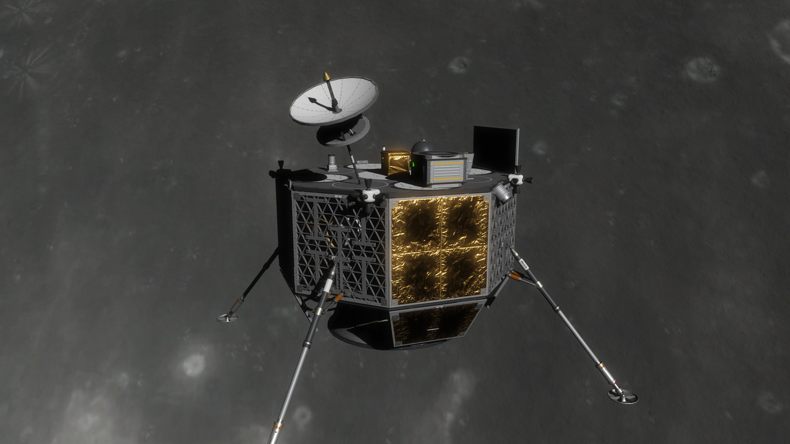

*An earlier Mosaic 1 lander: two Oct Decks with four Capsule Tanks between them, open isogrid walls that carry four long legs, gold foil, radiator and solar walls, and a Thrust Cone with seven Mizar engines. The probe core, the battery and the RCS blocks are stock parts; the dish and the small instruments on the deck are Facet parts.*

A later Mosaic 1 configuration with the Tessera Avionics Box landed from a 30 km lunar orbit in game tests.

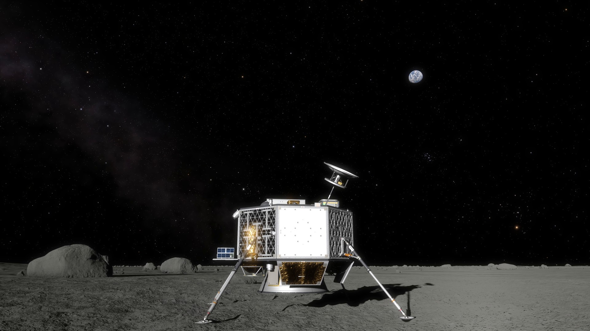

*A Tessera lander after its landing on the Moon, a frame of the game.*

## Parts

The kit has 21 parts with 41 variants. Each part is one entry in the editor; press V to change its variant (its look).

| Picture | Part | What it is |
| --- | --- | --- |
| 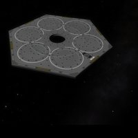 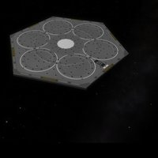 | **Tessera Hex Deck** | Hexagonal deck with seats for tanks and engines and six edges for panels; open or closed |
| 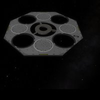 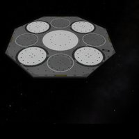 | **Tessera Oct Deck** | Octagonal deck with four tank openings and eight edges for panels; open or closed |
| 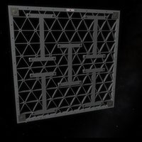 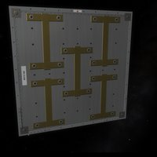 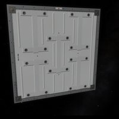 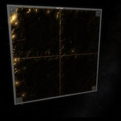 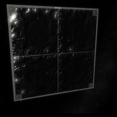 | **Tessera Wall Panel** | Wall of 1.0 by 1.0 m with leg pads at its lower corners; isogrid, skin, radiator, gold foil, silver foil |
| 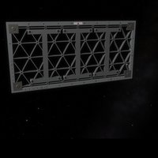 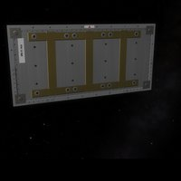 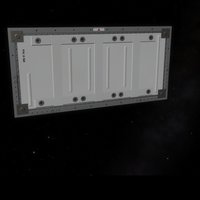 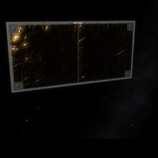 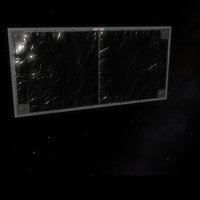 | **Tessera Half Panel** | Wall of 1.0 by 0.5 m with leg pads at its lower corners; the same five looks |
| 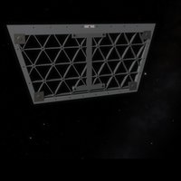 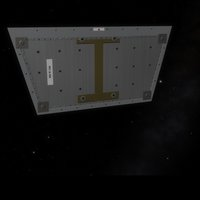 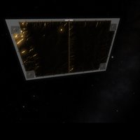 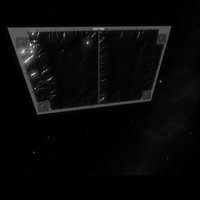 | **Tessera Taper Panel** | Tapered panel for a slanted skirt or a leg bracket; isogrid, skin, gold foil, silver foil |
| 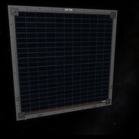 | **Tessera Solar Wall Panel** | Wall of solar cells, 420 W |
| 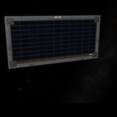 | **Tessera Solar Half Panel** | Half wall of solar cells, 210 W |
| 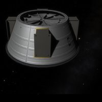 | **Tessera Thrust Cone** | Cone with a centre engine seat, a ring of twelve engine seats and a leg ring |
| 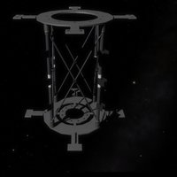 | **Tessera Core Column** | Carbon truss column between two decks that passes fuel |
| 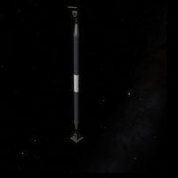 | **Tessera Deck Strut** | Carbon strut for masts and braces |
| 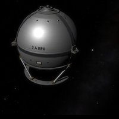 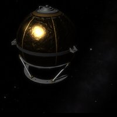 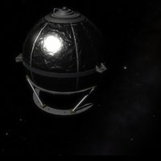 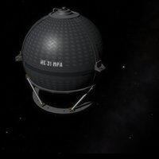 | **Tessera Sphere Tank** | Round tank, 92 kg of Methalox; bare, gold blanket, silver blanket, carbon bottle |
| 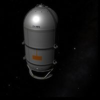 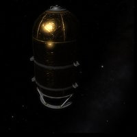 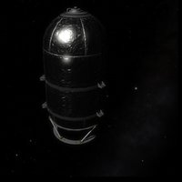 | **Tessera Capsule Tank** | Long tank, 231 kg of Methalox; bare, gold blanket, silver blanket |
| 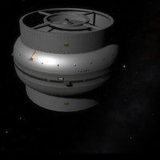 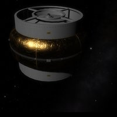 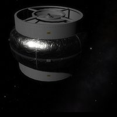 | **Tessera Drum Tank** | Wide low tank, 1.2 m wide, 499 kg of Methalox; bare, gold blanket, silver blanket |
| 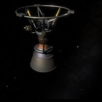 | **Mizar** | Descent engine on Methalox, 3.1 kN, 316 s in vacuum, gimbal range 4 degrees and slew up to 8 degrees per second |
| 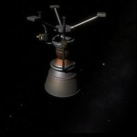 | **Mizar Fixed** | The same engine on a fixed mount |
| 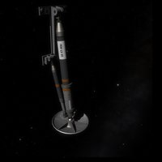 | **Tessera Landing Leg (short)** | Landing leg that deploys |
| 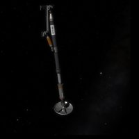 | **Tessera Landing Leg (long)** | Longer landing leg that deploys |
| 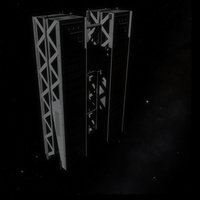 | **Tessera Lattice Ramp** | Ramp of 2.6 m that folds against the hull and deploys to the ground |
| 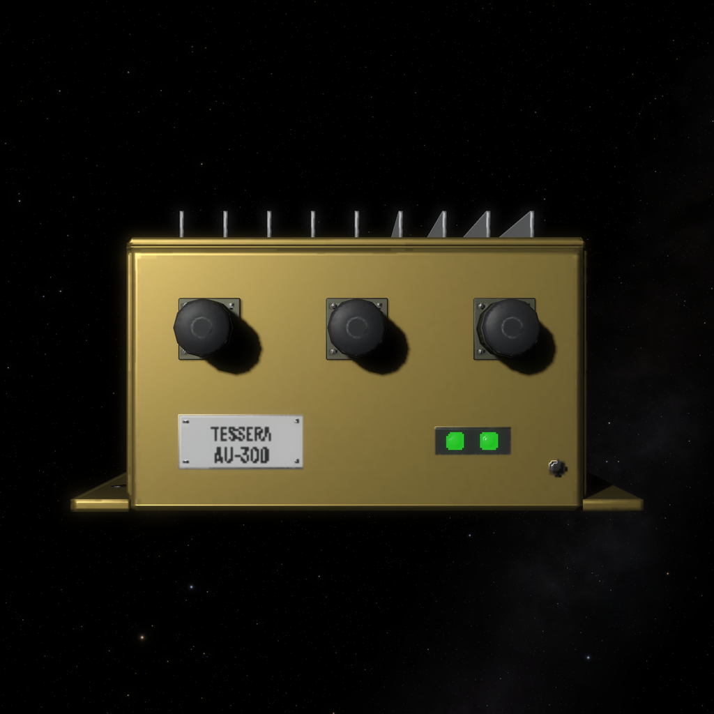 | **Tessera Avionics Box** | 14 kg uncrewed control unit with a power switch, status light and 720 kJ battery. Draws 20 W. |
| 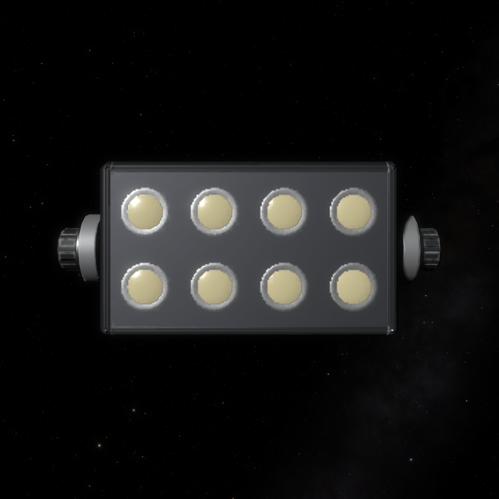 | **Tessera Floodlight** | 2.5 kg surface-mounted spotlight with a 90-degree tilt range. Starts off and draws 40 W when on. |
| 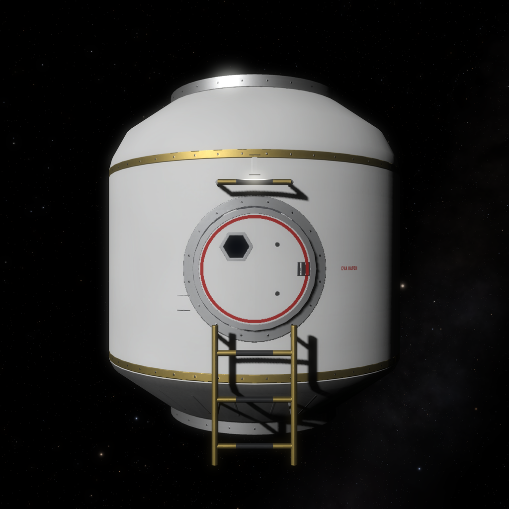 | **Tessera Crew Cabin** | Pressurized two-seat cabin with an interior, EVA exits and handholds. About 1,367.5 kg dry. |

Original parts and looks on one sheet: [images/parts/all-parts.jpg](images/parts/all-parts.jpg)

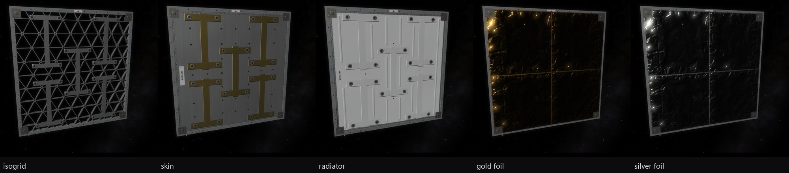

The tanks hold the true volume of their shape, so a stock tank of the same size holds about four times as much.

Use the Avionics Box for uncrewed control. Its avionics have a radiation tolerance of 300 Gy, an upset dose of 270 mSv and 1 g/cm2 of shielding.

The Crew Cabin provides control when an able crew member is aboard. It has a 905 kg polyethylene storm shelter liner. A full cabin carries about 7.13 kg of air, 25.62 kg of water and 27 meals, enough for about four days with two kittens.

## Building a lander

- Start with a deck. Tanks and engines stand on the round seats of a deck, the Oct Deck also takes a tank through each opening.
- Fuel passes through every joint between tanks, decks, columns, the cone and engines, so a tank on a deck feeds an engine under it.
- A panel snaps to a deck edge, on the top or the bottom face. The roll key turns it on the edge hinge in stops of 0, 26.57, 45, 63.43 and 90 degrees; Shift adds 5 degrees.
- A leg snaps to the leg pads of a wall or half panel or to the leg ring of the cone. Deploy it from its part menu.
- The ramp snaps to the outer edge face of a deck and deploys from its part menu.
- Put the Avionics Box on a deck station or a panel face. Mount the Crew Cabin on a deck station for a crewed lander.
- Put the Floodlight on a surface and connect it to a power supply. Switch it on and use the Actuate slider in the part menu to aim it.
- Use the side mounts to put Sphere and Capsule Tanks on a surface. Hold the tank near a deck station to use the stack connection. The side mounts do not pass fuel, so plan a fuel path to the engine.
- The Thrust Cone and Core Column use stack connections. The Hex and Oct Decks show more of their top faces in the part picker.
- The engine scale steps by 0.25. Mass and propellant change with the cube of the scale, thrust with its square.

| Hex tier | Tank cluster |
| --- | --- |
| 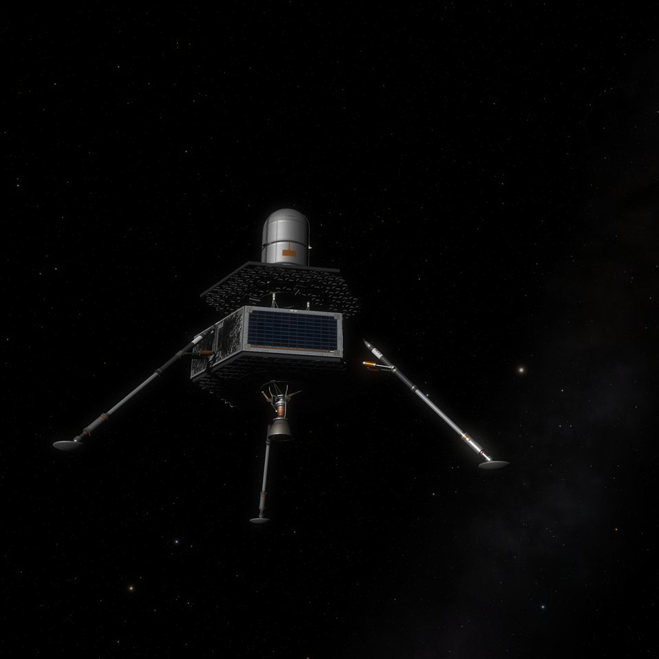 | 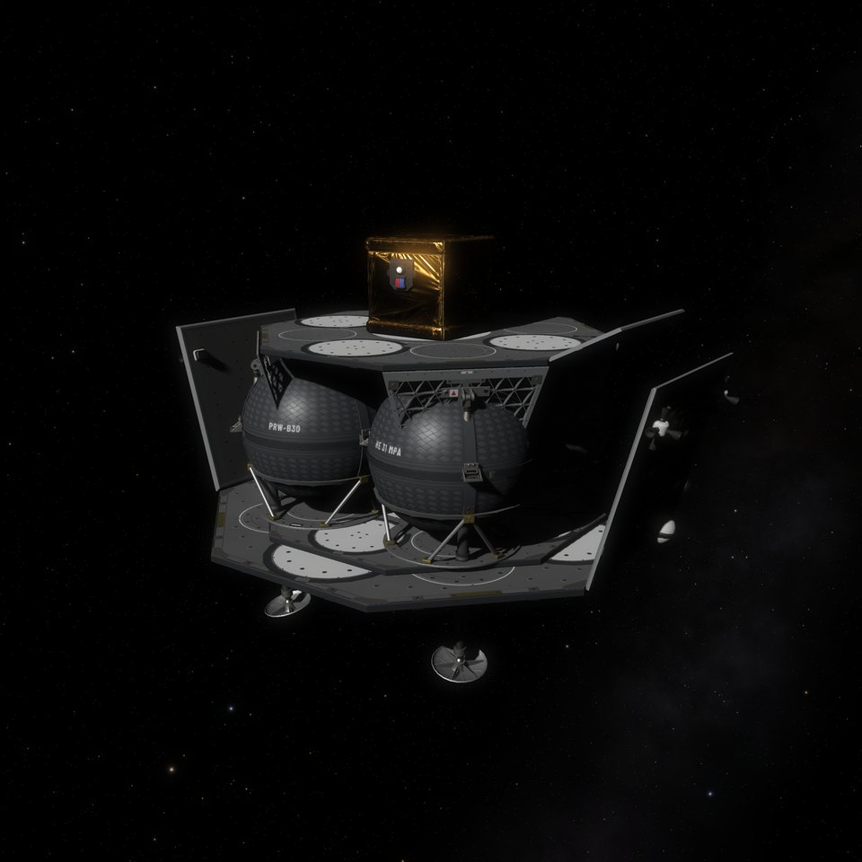 |
| Two Hex Decks on a Core Column, Half Panels in all five looks, a Solar Half Panel and three long legs, deployed. | Four Sphere Tanks in the carbon look on an Oct Deck, between two leaning Solar Wall Panels. |

| Engine cone | Legs deployed |
| --- | --- |
| 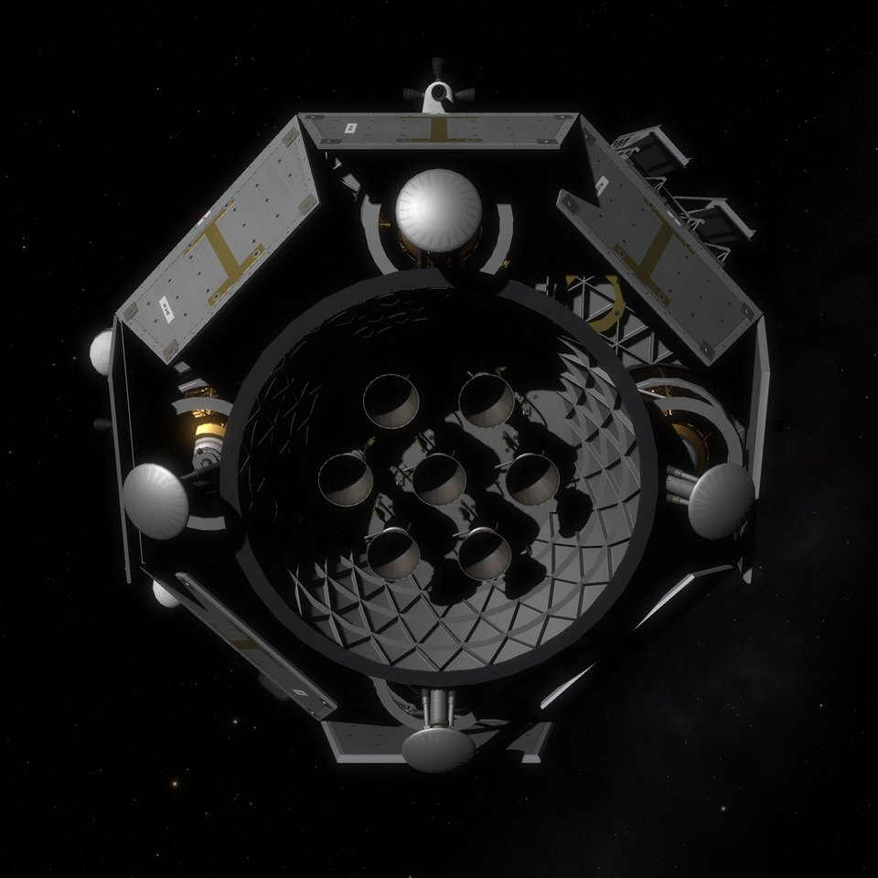 | 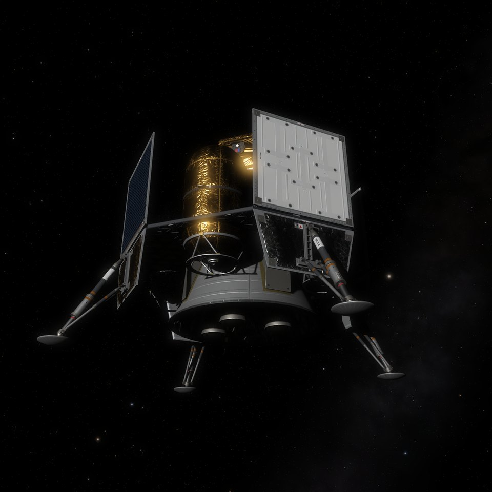 |
| A Thrust Cone with seven Mizar Fixed on its seats, seen from below. | Four short legs on Taper Panel skirts, deployed, over a Thrust Cone with five Mizar Fixed. |

## Example landers

These landers were built in the editor from the parts above. The mod contains no vehicle files; the pictures show what the kit can make.

| | |
| --- | --- |
| 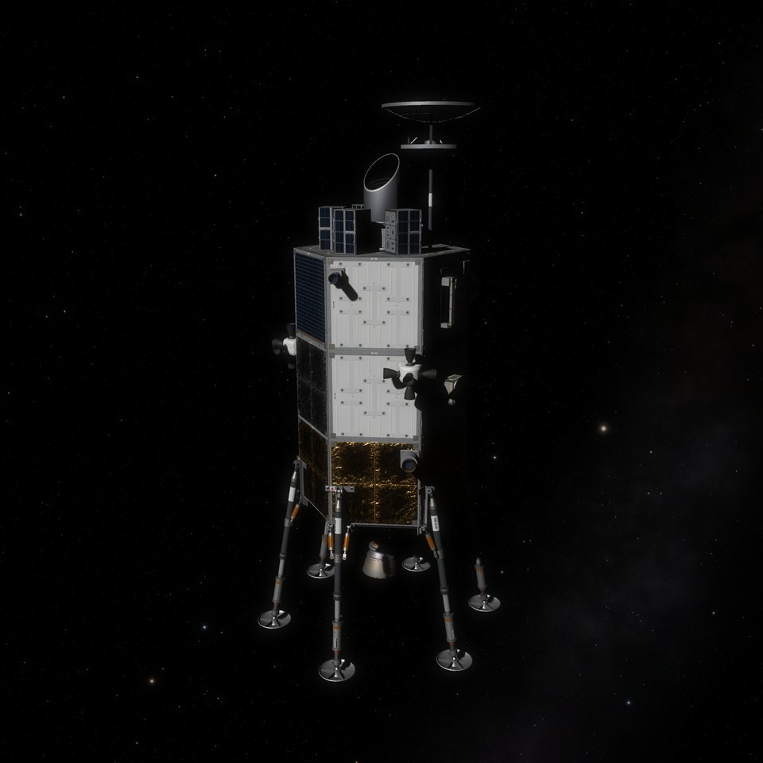 | 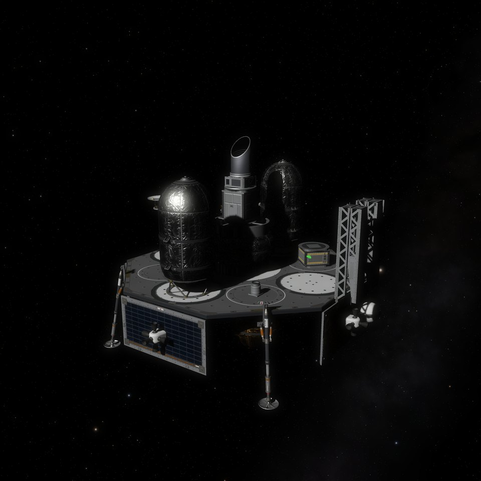 |
| **Tall hex lander:** two Hex Decks, three silver Drum Tanks on the axis, one Mizar, gold and silver foil, radiator and solar walls, six long legs. | **Wide octagonal cargo lander:** a closed Oct Deck on a Thrust Cone with four Mizar Fixed, four gold Sphere Tanks, two silver Capsule Tanks and a silver Drum Tank, four long legs. |
|  |  |
| **Lander with a slanted hull:** an Oct Deck on a Thrust Cone with seven Mizar Fixed, a hull of Taper Panels, gold Sphere and Drum Tanks, Solar Half Panels, four short legs on the cone. | **Two-tier gold lander:** two closed Oct Decks, four gold Capsule Tanks, twelve gold Taper Panels, one Mizar, four long legs. |
|  |  |
| **Hex tower lander:** two Hex Decks, three tiers of Wall Panels in all five looks and Solar Wall Panels, two silver Drum Tanks, one Mizar, six long legs. | **Small hex hopper:** one Hex Deck, three Sphere Tanks, one Mizar Fixed, Solar Half Panels and gold walls with short legs. |

Some landers in the pictures carry payload parts of [Facet by Purrline Rocketworks](https://github.com/Maximilian-Nesslauer/KSA-PurrlineFacet).

## Install

No other mod needed.

- Borea: install Tessera from the content list.
- By hand: copy `PurrlineTessera` from the release zip into `Documents/My Games/Kitten Space Agency/mods/` and enable it.

To remove the mod, delete its folder. Vehicles with its parts do not load without it.

## Licence

Code and game data: MIT ([LICENSE](LICENSE)). Meshes, textures, logo and pictures: CC BY 4.0 ([LICENSE-ART](LICENSE-ART)). Credits: [NOTICE.md](NOTICE.md).

## Links

[Forum thread](https://forums.ahwoo.com/forums/kitten-space-agency/mod-releases/tessera-by-purrline-rocketworks.1698/) | [Issues](https://github.com/Maximilian-Nesslauer/KSA-PurrlineTessera/issues)
